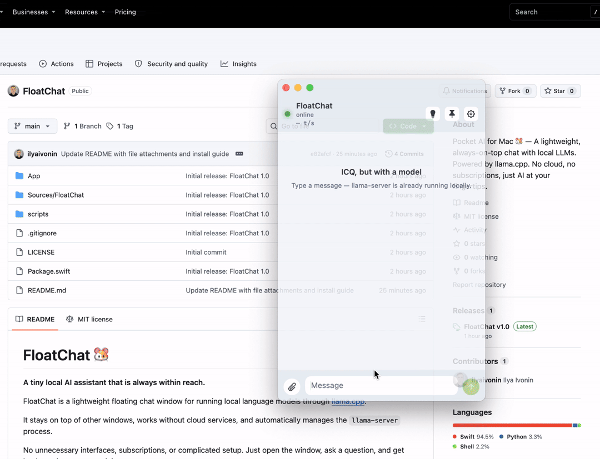
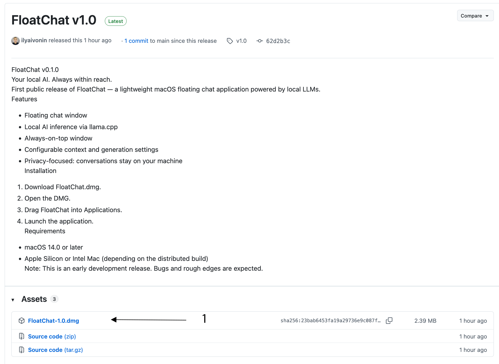
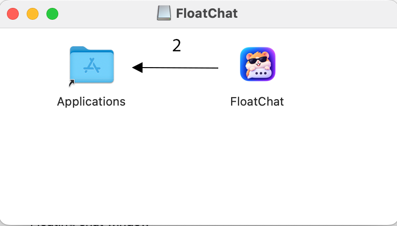
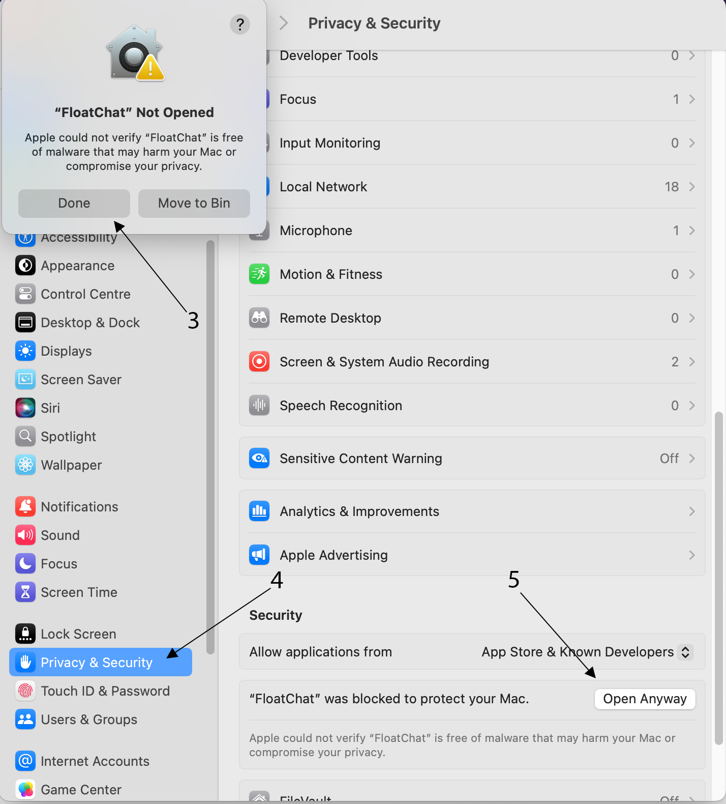

# FloatChat 🐹

<p align="center">
  
</p>

<p align="center">
  <strong>A tiny local AI assistant that is always within reach.</strong>
</p>

<p align="center">
  <a href="https://github.com/ilyaivonin/FloatChat/releases/latest">
    
  </a>
  <a href="https://github.com/ilyaivonin/FloatChat/blob/main/LICENSE">
    
  </a>
  
  
  
</p>

<p align="center">
  <a href="https://github.com/ilyaivonin/FloatChat/releases/latest">
    
  </a>
</p>

---

FloatChat is a lightweight floating chat window for running local language models through [llama.cpp](https://github.com/ggml-org/llama.cpp).

It stays on top of other windows, works without cloud services, and automatically manages the `llama-server` process.

No unnecessary interfaces, subscriptions, or complicated setup. Just open the window, ask a question, and get back to what you were doing.

## ✨ Features

- **Always on Top** — keep the chat window above other applications.
- **Window Transparency** — adjustable opacity from 30% to 100%.
- **Fully Local** — interact with local models through llama.cpp, without cloud services.
- **Automatic Server Management** — starts, stops, and restarts `llama-server` automatically.
- **llama.cpp Installation** — download official builds from GitHub or use Homebrew as a fallback.
- **Model Management** — select local GGUF models through the native file picker and open their Hugging Face pages.
- **File Attachments** — attach PDF, TXT, MD, CSV, JSON, RTF, HTML, and other text-based files directly to messages.
- **Performance Settings** — configure CPU threads, context size, server port, and generation parameters.
- **Personalization** — rename the application and adjust window transparency.
- **Separate Settings Window** — configure the application without interrupting your chat.
- **Convenient Input** — the message field expands up to five lines and supports scrolling for longer drafts.
- **Keyboard Shortcuts** — paste using `⌘V` and `⌥V` in all text fields.
- **Error Handling** — server crashes are reported immediately with an error message and a restart option.



## 📎 File Attachments

You can attach the following file types to messages:

- PDF
- TXT
- Markdown
- CSV
- JSON
- RTF
- HTML
- Other text-based formats

File contents are extracted locally and sent to the model along with your message.

## 🖥️ Compatibility

- macOS 14 Sonoma or later.
- Apple Silicon (M1, M2, M3, M4 and newer).
- Intel Macs (x86_64).
- Universal Binary support.

FloatChat is designed for compact local models and everyday tasks: quick questions, small writing tasks, useful hints, and on-the-go assistance.

It is not designed to compete with large cloud-based AI models. It is a lightweight tool that is always there when you need it.

## 🚀 Installing

### 1. Download FloatChat

1. Visit the [FloatChat Releases](https://github.com/ilyaivonin/FloatChat/releases) page.
2. Open the latest release.
3. Download the `FloatChat.dmg` file.

### 2. Install the application

1. Open the downloaded `FloatChat.dmg` file.
2. A Finder window will appear.
3. Drag `FloatChat.app` into the **Applications** folder.
4. Wait for the copy process to finish.
5. Eject the mounted DMG.

### 3. Launch FloatChat

1. Open your **Applications** folder.
2. Find **FloatChat**.
3. Double-click the application to launch it.

**Don't worry if macOS blocks the application.**

Since FloatChat is currently distributed without Apple Developer ID notarization, macOS Gatekeeper may prevent it from opening on the first launch.

This is expected for this development release.

### 4. Allow FloatChat in macOS Security Settings

If macOS displays a security warning:

1. Open **System Settings**.
2. Navigate to **Privacy & Security**.
3. Scroll down to the **Security** section.
4. Find the message stating that FloatChat was blocked.
5. Click **Open Anyway**.

### 5. Confirm the launch

1. A confirmation dialog will appear.
2. Click **Open Anyway** or **Open**, depending on the dialog.
3. Authenticate using your Mac administrator password or Touch ID if requested.

That's it! macOS will remember your decision, and you should be able to launch FloatChat normally from now on.

### Installation Screenshots

<table>
  <tr>
    <td align="center" width="33%">
      <strong>Step 1 — Download</strong><br><br>
      
    </td>
    <td align="center" width="33%">
      <strong>Step 2 — Install</strong><br><br>
      
    </td>
    <td align="center" width="33%">
      <strong>Step 3 — Allow Access</strong><br><br>
      
    </td>
  </tr>
</table>

---

## 🚀 Building

Clone the repository:

```bash
git clone https://github.com/ilyaivonin/FloatChat.git
cd FloatChat
```

Build the application:

```bash
./scripts/build-app.sh
```

Output:

```text
dist/FloatChat.app
```

To create a distributable DMG:

```bash
./scripts/build-dmg.sh
```

Output:

```text
dist/FloatChat-1.0.dmg
```

The build scripts compile both architectures (`arm64` and `x86_64`) and combine them using `lipo`.

## ⚙️ Installing llama.cpp

On startup, FloatChat searches for `llama-server` in standard locations.

If the server is not found, the following installation options are available:

**Automatic Installation**

The "Install Automatically" button downloads the latest official llama.cpp build from GitHub to:

```text
~/Library/Application Support/FloatChat/llama.cpp/current
```

**Custom Installation**

The "Reinstall…" button lets you choose a directory. A fresh build will be installed to:

```text
<selected-folder>/llama.cpp/current
```

**Homebrew**

If GitHub is unavailable, FloatChat can fall back to:

```bash
brew install llama.cpp
```

The appropriate build architecture is detected automatically:

- `macos-arm64` — Apple Silicon.
- `macos-x64` — Intel.

## 🧠 Setting Up a Model

FloatChat supports GGUF models.

Example:

[Qwen3.8-4B-Distill-GGUF](https://huggingface.co/empero-ai/Qwen3.8-4B-Distill-GGUF)

After downloading a model, select its `.gguf` file in Settings or use the "Browse…" button.

Available configuration options:

| Parameter | Maximum value |
|---|---:|
| Context size | 64,000 tokens |
| Response token limit | 32,000 tokens |
| Reasoning budget | 32,000 tokens |

You can also configure the number of CPU threads and the server port.

To apply a new model or configuration, click **"Apply and Restart"**. FloatChat will stop the current server process and launch it again with the updated settings.

**Limitations:**

- Up to 60,000 characters per file.
- Up to 120,000 characters in total.
- PDFs are processed using PDFKit.
- Scanned PDFs without an embedded text layer are not supported.

## 📁 Project Structure

```text
FloatChat/
├── Sources/
│   └── FloatChat/     # Application source code
├── App/               # Info.plist and application icon
├── scripts/           # Build, DMG, and icon scripts
├── docs
│   └──images/         # README screenshots and media
└── README.md
```

## 🔒 Privacy & Security

FloatChat is designed for local use.

- Conversations are processed by a local model.
- No cloud API is required for text generation.
- Internet access is only needed to initially download llama.cpp and models.
- The application does not use App Sandbox.
- The application is not signed with an Apple Developer certificate (ad-hoc signing is used).

macOS Gatekeeper may require additional approval when launching the application for the first time.

## 📄 License

This project is licensed under the MIT License.

See the [LICENSE](LICENSE) file for details.

---

<p align="center">
  <strong>FloatChat — your AI, always within reach.</strong><br>
  🐹
</p>
