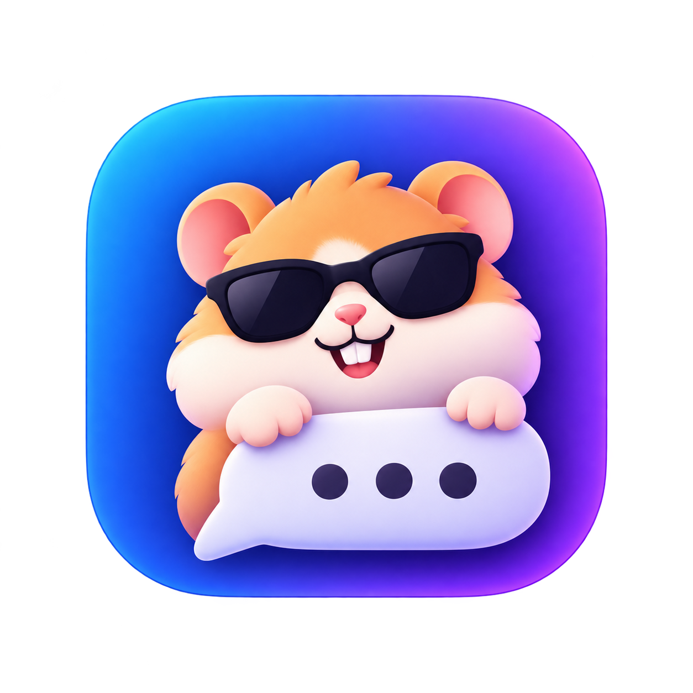

# FloatChat 🐹

<p align="center">
  
</p>

<p align="center">
  <strong>Маленький локальный ИИ-помощник, который всегда под рукой.</strong>
</p>

<p align="center">
  <a href="https://github.com/ilyaivonin/FloatChat/releases/latest">
    
  </a>
  <a href="https://github.com/ilyaivonin/FloatChat/blob/main/LICENSE">
    
  </a>
  
  
  
</p>

---

FloatChat — это лёгкое плавающее окно чата для локальных языковых моделей, работающих через [llama.cpp](https://github.com/ggml-org/llama.cpp).

Окно остаётся поверх других приложений, не требует облачных сервисов и само управляет процессом `llama-server`.

Никаких лишних интерфейсов, подписок и сложной настройки. Откройте окно, задайте вопрос и вернитесь к своим делам.

---

## ✨ Возможности

- **Поверх всех окон** — чат всегда остаётся на виду.
- **Прозрачность окна** — регулировка от 30% до 100%.
- **Полностью локально** — общение с моделями через llama.cpp без облака.
- **Автоматическое управление сервером** — запуск, остановка и перезапуск `llama-server`.
- **Установка llama.cpp** — загрузка официальных сборок с GitHub или установка через Homebrew.
- **Каталог моделей** — пять готовых GGUF-моделей с прямыми ссылками и выбор своего файла.
- **Вложения** — PDF, TXT, MD, CSV, JSON, RTF, HTML и другие текстовые файлы.
- **Тонкие настройки** — потоки, размер батча, контекст, порт и параметры генерации.
- **Персонализация** — своё название приложения и прозрачность окна.
- **Отдельное окно настроек** — конфигурация не прерывает чат.
- **Горячие клавиши** — вставка через `⌘V` и `⌥V` во всех текстовых полях.
- **Обработка ошибок** — падение сервера сразу показывается с предложением перезапуска.

## 🖥️ Совместимость

- macOS 14 Sonoma или новее.
- Apple Silicon (M1, M2, M3, M4 и новее).
- Intel Mac (x86_64).
- Universal Binary.

FloatChat рассчитан на компактные локальные модели и повседневные задачи: быстрые вопросы, небольшие тексты, подсказки.

## 🚀 Установка

### 1. Скачайте FloatChat

1. Откройте страницу [релизов FloatChat](https://github.com/ilyaivonin/FloatChat/releases).
2. Выберите последний релиз.
3. Скачайте файл `FloatChat.dmg`.

### 2. Установите приложение

1. Откройте скачанный `FloatChat.dmg`.
2. Перетащите `FloatChat.app` в папку **Applications**.
3. Дождитесь окончания копирования и извлеките DMG.

### 3. Запустите FloatChat

Откройте **Applications**, найдите **FloatChat** и запустите его.

Если macOS блокирует запуск:

1. Откройте **Системные настройки → Конфиденциальность и безопасность**.
2. Найдите сообщение о блокировке FloatChat.
3. Нажмите **Открыть всё равно** и подтвердите действие.


## 🔨 Сборка

```bash
git clone https://github.com/ilyaivonin/FloatChat.git
cd FloatChat
./scripts/build-app.sh
```

Результат:

```text
dist/FloatChat.app
```

Для создания DMG:

```bash
./scripts/build-dmg.sh
```

Результат:

```text
dist/FloatChat-<версия>.dmg
```

В DMG также попадают `README.md` и `README_RU.md` .

### Каталог моделей (`models.json`)

**Настройки → Скачать модель…** читается из `models.json` в корне проекта. Меняйте названия кнопок, описания, размеры и прямые ссылки на `.gguf` внутри настроек или замените файл своим перед сборкой — скрипт сборки копирует его в `FloatChat.app/Contents/Resources`.

```json
{
  "models": [
    {
      "name": "Qwen3.8-4B — Q4_K_M",
      "url": "https://huggingface.co/empero-ai/Qwen3.8-4B-Distill-GGUF/resolve/main/Qwen3.8-4B-Q4_K_M.gguf?download=true",
      "size": "2.8 GB",
      "text": "Описание (рус.)",
      "text_en": "Description (English)",
      "page": "https://huggingface.co/empero-ai/Qwen3.8-4B-Distill-GGUF"
    }
  ]
}
```

Обязательны только `name` и `url`. Скачанные модели сохраняются в `~/Downloads/FloatChat`, логи и история переписки — в `~/Documents/FloatChat`.

### Подсказка при первом запуске (`howto.md`)

## 🚀 Как пользоваться

### 1. Установите llama.cpp

1. Запустите FloatChat и откройте **Настройки**.
2. Найдите раздел **llama.cpp**.
3. Нажмите **Установить автоматически** справа от заголовка раздела.
4. Дождитесь окончания загрузки и установки.

Кнопки установки находятся справа от заголовка **llama.cpp**. **Установить автоматически** показывается, только если `llama-server` не найден; **Переустановить…** доступна всегда и позволяет выбрать папку.

### 2. Скачайте модель

1. Откройте настройки и нажмите **Скачать модель…**.
2. Выберите одну из пяти готовых моделей и нажмите кнопку загрузки.
3. Файлы сохраняются в `~/Downloads/FloatChat`.
4. Можно также скачать любой GGUF-файл вручную и выбрать его кнопкой **Обзор…**.

### 3. Выберите модель и запустите

1. Укажите `.gguf`-файл в настройках.
2. Нажмите **Применить и перезапустить**.
3. Дождитесь загрузки модели — в статусе появится **Model Online** и зелёный индикатор.

Готово! Облачные аккаунты, API-ключи и подписки не нужны.

### Стандартные настройки

| Параметр | Значение |

| Контекст (`ctx -c`) | 8 192 |
| Порт | 4 096 |
| Потоки (`threads -t`) | 4 |
| Батч (`batch -tb`) | 4 |

Потоки, батч, контекст и порт находятся в разделе **Тонкие настройки**. Кнопка **Сбросить настройки** справа от **Поверх всех окон** возвращает стандартные значения.

Максимальный бюджет рассуждений — 8 192 токена, максимум токенов ответа — 32 000.

**Ограничения вложений:**

- До 60 000 символов на файл.
- До 120 000 символов суммарно.
- PDF обрабатываются через PDFKit; сканы без текстового слоя не поддерживаются.

## 📁 Структура проекта

```text
FloatChat/
├── Sources/
│   └── FloatChat/     # Исходный код приложения
├── App/               # Info.plist и иконка приложения
├── scripts/           # Скрипты сборки, DMG и иконки
├── docs
│   └── images/        # Скриншоты и медиа для README
├── models.json        # Каталог моделей для окна загрузки
├── howto.md           # Текст подсказки при первом запуске
├── README.md
└── README_RU.md
```

## 🔒 Приватность и безопасность

- Переписка обрабатывается локальной моделью.
- Для генерации текста облачные API не используются.
- Интернет нужен только для первичной загрузки llama.cpp и моделей.
- Приложение не использует App Sandbox.

## 📄 Лицензия

Проект распространяется по лицензии MIT. Подробности — в файле [LICENSE](LICENSE).

---

<p align="center">
  <strong>FloatChat — ваш ИИ всегда под рукой.</strong><br>
  🐹
</p>
